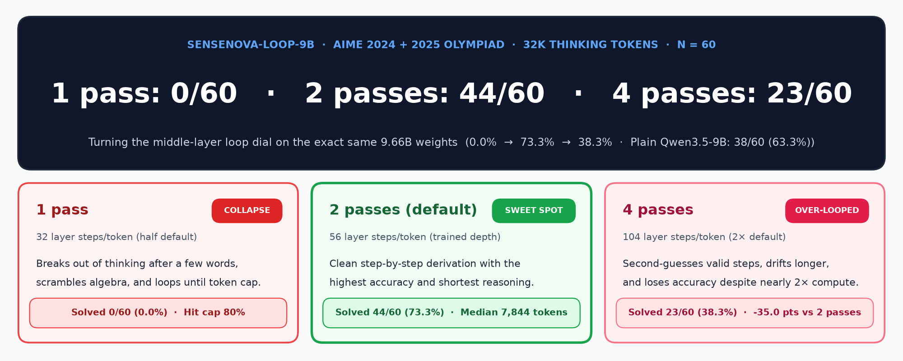
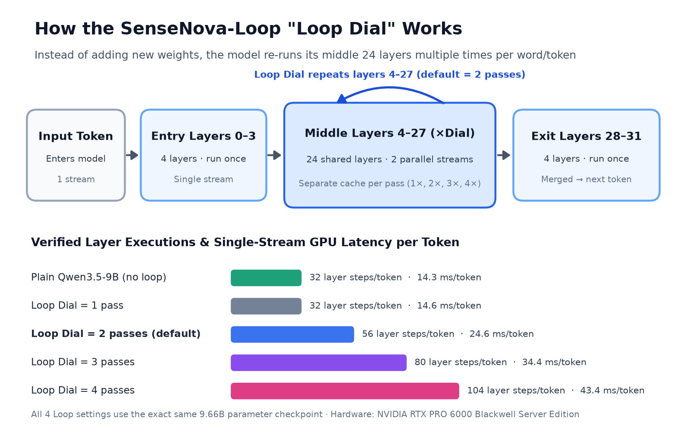
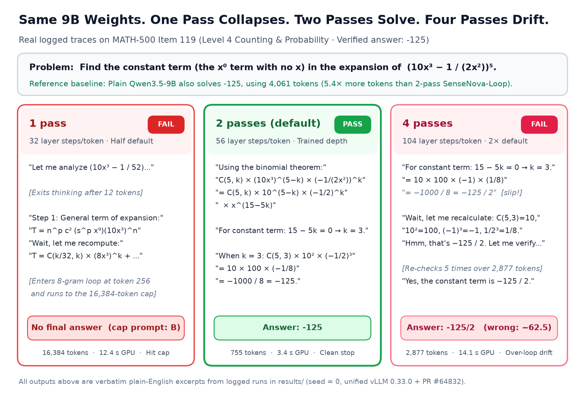
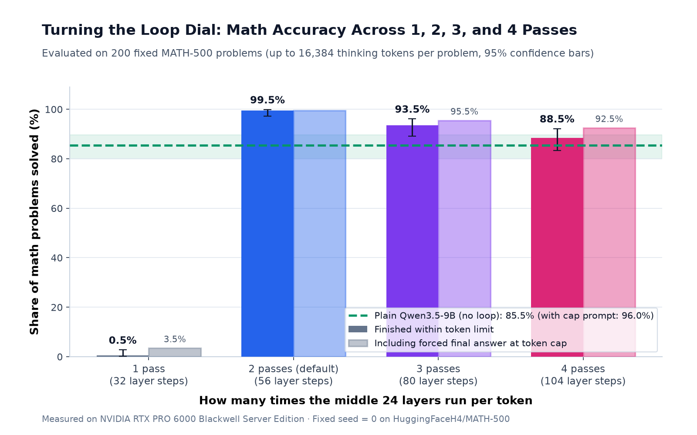
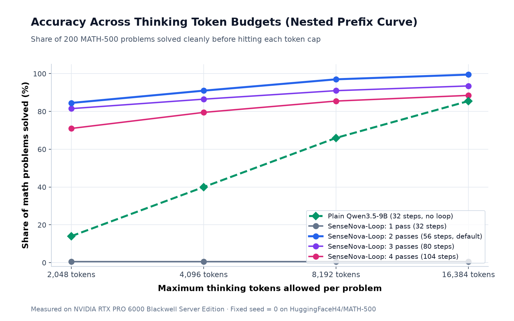
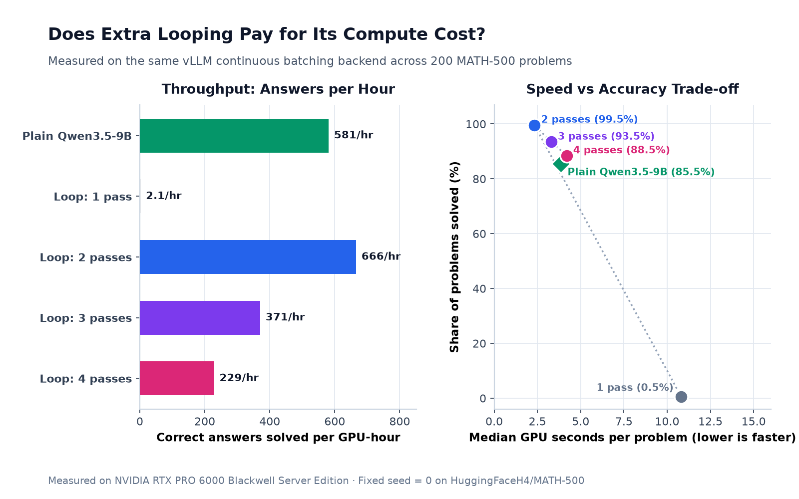
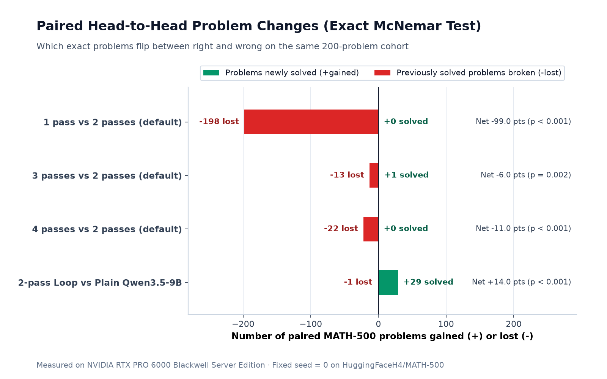
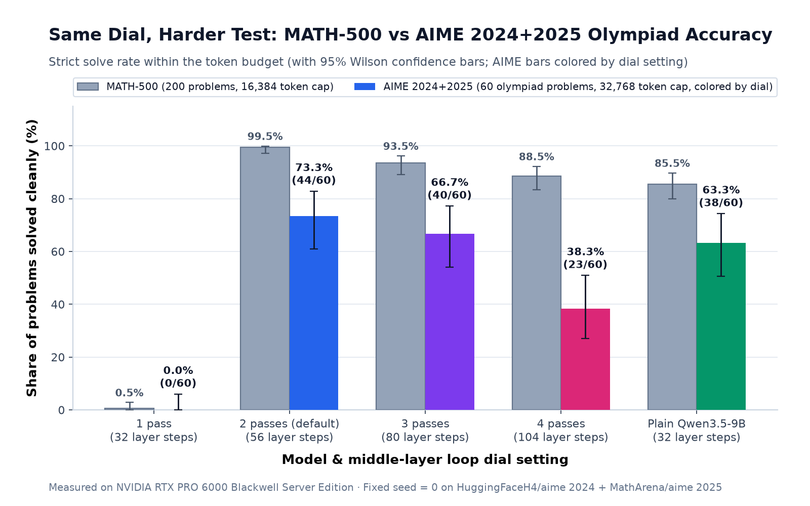
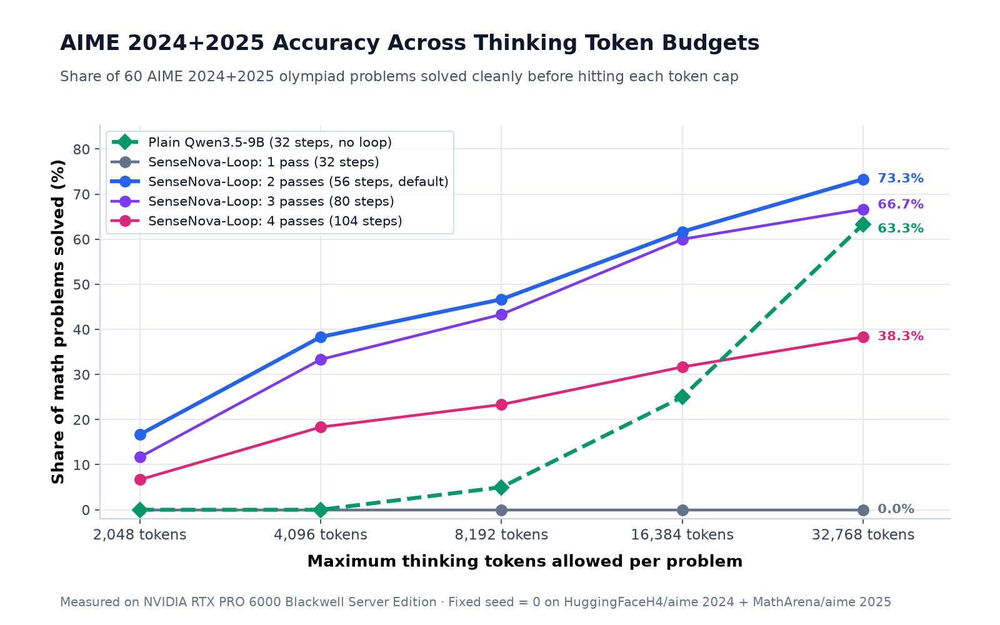
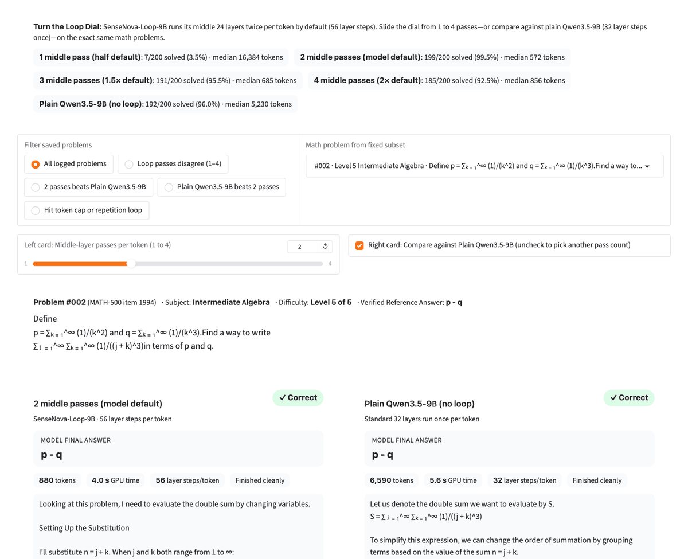

# Turn the Loop Dial

[](https://colab.research.google.com/github/DavidFlorez/loop-dial/blob/main/notebooks/loop_dial_colab.ipynb)



**`SenseNova-Loop-9B-Preview` runs its middle 24 layers twice per token (`56` layer steps instead of `32`). What happens if you turn that "loop dial" to `1, 2, 3, or 4` passes at test time — and is it actually better than just running plain `Qwen3.5-9B`?**

---

## The Short Answer (`MATH-500` `N = 200` at `16k` Tokens + `AIME 2024 + 2025` `N = 60` at `32k` Tokens)

1. **Yes — the default `2`-pass loop beats plain `Qwen3.5-9B` on clean accuracy and dominates under practical token budgets because latent depth substitutes for long verbal chains of thought.**
   - **On `MATH-500` (`N = 200`, `16,384`-token cap):** `2` passes solves **`99.5%` vs `85.5%`** cleanly (`199/200` vs `171/200`, paired McNemar `p = 5.8 × 10⁻⁸`), and **`99.5%` vs `96.0%`** even after giving capped traces a 512-token forced-answer rescue (`p = 0.039`). Although running `56` layer steps per token is slower *per token* than `Qwen3.5-9B`'s `32` steps, `2` passes thinks in **`9.1×` fewer median tokens** (`572` vs `5,230`) and wins on GPU efficiency (**`666` vs `581`** clean correct answers/GPU-hr).
   - **On `AIME 2024 + 2025` (`N = 60` olympiad problems, `32,768`-token cap):** Once `2` passes is well off the ceiling (**`73.3%`** clean, `44/60`), it still leads plain `Qwen3.5-9B` (**`63.3%`** clean, `38/60`) by **`+10.0 pp`** cleanly (`+12` gained / `-6` lost, `p = 0.238`) while using **`3.5×` fewer median tokens** (`7,844` vs `27,268`). At a `16,384`-token budget, `2` passes leads `Qwen3.5-9B` **`61.7%` vs `25.0%`** (`37/60` vs `15/60`); only when `Qwen3.5-9B` is given all `32,768` tokens *plus* a 512-token forced-answer rescue on its `21` capped runs (`35.0%` cap rate) do the two models tie at **`76.7%` (`46/60`)**.
2. **No — turning the loop dial away from `2` passes *without retraining* never beats the trained `2`-pass sweet spot, even on hard olympiad math.**
   - **`1` pass (`32` steps) collapses completely:** `0.5%` clean (`1/200`) on `MATH-500` and **`0.0%` (`0/60`, both clean and forced)** on `AIME 2024 + 2025` (`p = 1.1 × 10⁻¹³`) because the final 4 exit layers receive an unfinished internal representation.
   - **`3` passes (`80` steps) rescues a few slips on AIME (`+6` gained) while pushing more runs into the cap (`-10` lost), ending statistically tied with `2` passes at `1.6×` higher GPU cost:** `66.7%` clean (`40/60`, `p = 0.454`) and `78.3%` forced (`47/60` vs `46/60`, `p = 1.00`), dropping efficiency from `72.0` to `40.8` clean correct answers/GPU-hr (and `-6.0 pp` on `MATH-500`, `p = 0.0018`).
   - **`4` passes (`104` steps) breaks sharply on long derivations:** What looked like an `-11.0 pp` dip on `MATH-500` (`88.5%`, `p = 4.8 × 10⁻⁷`) turns into a **`-35.0 pp` collapse on AIME (`38.3%` clean, `23/60`, `p = 1.9 × 10⁻⁵`; `53.3%` forced, `p = 0.0026`)**, with `50.0%` hitting the `32k` cap and `26.7%` entering 8-gram repetition loops.



### What Turning the Dial Looks Like on One Real Logged Problem

Before looking at aggregate curves, here is what `1 pass`, `2 passes (default)`, and `4 passes` actually write on the exact same logged `MATH-500` problem (`test/counting_and_probability/119.json`, gold answer `-125`):



---

## Part 1: `MATH-500` Sweep (`N = 200`, `16,384`-Token Cap)

Every number below comes directly from logged runs in [`results/`](results/) (`seed = 0`, identical sampling across all 5 conditions on the same `vllm==0.33.0` + PR `#64832` engine on an NVIDIA RTX PRO 6000 Blackwell 96 GB GPU):

| Condition | Layer Steps / Token | Solved Cleanly (`≤16,384` tokens) | Solved w/ Cap Forced Answer | Hit `16k` Token Cap | Median Thinking Tokens | Correct Answers / GPU-Hour (Clean / Forced) |
| --- | ---: | ---: | ---: | ---: | ---: | ---: |
| **1 pass** (`SenseNova-Loop`) | `32` | `0.5%` (`1/200`) | `3.5%` (`7/200`) | `72.5%` | `16,384` | `2` / `15` |
| **2 passes — model default** (`SenseNova-Loop`) | **`56`** | **`99.5%` (`199/200`)** | **`99.5%` (`199/200`)** | **`0.0%`** | **`572`** | **`666` / `666`** |
| **3 passes** (`SenseNova-Loop`) | `80` | `93.5%` (`187/200`) | `95.5%` (`191/200`) | `4.5%` | `685` | `371` / `378` |
| **4 passes** (`SenseNova-Loop`) | `104` | `88.5%` (`177/200`) | `92.5%` (`185/200`) | `9.0%` | `856.5` | `229` / `239` |
| **Plain `Qwen3.5-9B`** (no loop) | `32` | `85.5%` (`171/200`) | `96.0%` (`192/200`) | `14.5%` | `5,229.5` | `581` / `653` |

### Four `MATH-500` Charts

#### 1. Accuracy Peaks Sharply at the Trained 2-Pass Setting


#### 2. Under Tight Token Budgets, 2 Latent Passes Crush Long Verbal Monologues
At a **`2,048`-token** budget, `2`-pass `SenseNova-Loop-9B` already finishes **`84.5%`** of `MATH-500` problems cleanly, while plain `Qwen3.5-9B` has only finished **`14.0%`** (`86.0%` of Qwen's traces are still mid-calculation when the `2,048` cap cuts them off).



#### 3. Why a Slower Per-Token Model Wins Per GPU-Hour
Each `2`-pass token does more work (`56` layer steps + two-stream Sinkhorn routing + separate per-pass caches), but needing **`572` median tokens instead of `5,230`** puts `2` passes at the top-right efficiency frontier (`666` correct answers/GPU-hour).



#### 4. Paired Problem-by-Problem Gains & Losses (`N = 200`)
Because every model condition saw the **exact same 200 problems**, we test differences with exact two-sided McNemar tests on discordant pairs (`+29` gained vs `-1` lost cleanly against `Qwen3.5-9B`; `+1` gained vs `-13` lost at `3` passes; `+0` gained vs `-22` lost at `4` passes).



---

## Part 2: Harder Follow-Up — `AIME 2024 + 2025` Olympiad (`N = 60`, `32,768`-Token Cap)

On `MATH-500`, default `2` passes hit `99.5%` (`199/200`), leaving only 1 unsolved problem out of 200 for `3` or `4` passes to potentially improve upon. To test whether extra test-time passes unlock gains once problems are genuinely hard, we evaluated all **60 official `AIME 2024 + 2025` problems** (`HuggingFaceH4/aime_2024` + `MathArena/aime_2025`, [`data/aime_2024_2025.json`](data/aime_2024_2025.json)) on the **same unified `vllm==0.33.0` + PR `#64832` backend** at **`32,768` max new tokens** (`max_num_seqs = 16`, logged in [`results/aime/`](results/aime/)):

| Condition | Layer Steps / Token | Solved Cleanly (`≤32,768` tokens) | Solved w/ Cap Forced Answer | Hit `32k` Cap | Repetition Loop | Median Thinking Tokens | Correct Answers / GPU-Hour (Clean / Forced) |
| --- | ---: | ---: | ---: | ---: | ---: | ---: | ---: |
| **1 pass** (`SenseNova-Loop`) | `32` | `0.0%` (`0/60`) | `0.0%` (`0/60`) | `80.0%` | `31.7%` | `32,768` | `0` / `0` |
| **2 passes — model default** (`SenseNova-Loop`) | **`56`** | **`73.3%` (`44/60`)** | **`76.7%` (`46/60`)** | **`20.0%`** | **`8.3%`** | **`7,843.5`** | **`72` / `75`** |
| **3 passes** (`SenseNova-Loop`) | `80` | `66.7%` (`40/60`) | `78.3%` (`47/60`) | `30.0%` | `0.0%` | `10,786.5` | `41` / `48` |
| **4 passes** (`SenseNova-Loop`) | `104` | `38.3%` (`23/60`) | `53.3%` (`32/60`) | `50.0%` | `26.7%` | `32,061.5` | `13` / `18` |
| **Plain `Qwen3.5-9B`** (no loop) | `32` | `63.3%` (`38/60`) | `76.7%` (`46/60`) | `35.0%` | `0.0%` | `27,267.5` | `69` / `84` |

### Two `AIME 2024 + 2025` Charts

#### 1. Moving Off the `MATH-500` Ceiling Exposes the Real `4`-Pass Collapse (`-35.0 pp`, `p = 1.9 × 10⁻⁵`)
Even with `16` unsolved olympiad problems of headroom above `2` passes (`44/60`, identical `22/30` on both AIME 2024 and AIME 2025), turning the dial up without multi-depth training does not raise clean accuracy: `3` passes trades `+6` rescued slips against `-10` new cap timeouts (`40/60` clean, `47/60` forced — a statistical tie at `1.6×` higher GPU time), while `4` passes tumbles to `23/60` (`38.3%`).



#### 2. Olympiad Token-Budget Curve (`2,048` to `32,768` Tokens)
Plain `Qwen3.5-9B` solves **`0/60` (`0.0%`)** cleanly at `4,096` tokens and only **`15/60` (`25.0%`)** at `16,384` tokens because its median olympiad monologue is **`27,268` tokens** (`3.5×` longer than `2`-pass `SenseNova-Loop-9B` at `7,844` median tokens, which already solves **`38.3%` at `4k`** and **`61.7%` at `16k`**).



---

## Side-by-Side Interactive Explorer (`app.py`)

Switch between **`MATH-500` (`200` problems)** and **`AIME 2024+2025` (`60` olympiad problems)**, slide the loop dial from `1` to `4` passes—or toggle against plain `Qwen3.5-9B`—filter directly to disagreements, and expand each model's plain-English step-by-step reasoning:



Run it locally on any laptop (replays the saved runs in `results/` and `results/aime/`, **zero GPU required**):

```bash
uv venv .venv && source .venv/bin/activate
uv pip install -r requirements.txt
python app.py
```

On a GPU machine (or Colab), add `--enable-live-gpu` to also run custom math questions live across pass counts.

---

## Heads-Up for Mac / Local Quantization Users (`MLX` & `GGUF`)

> **Warning:** While testing local consumer inference on a 16 GB Apple M3 Mac ([`results/mac_mlx_check.json`](results/mac_mlx_check.json)), we verified that current community quantizations (`hermitdave/SenseNova-Loop-9B-Preview-MLX-slq-4.5bpw` and `AtomicChat/SenseNova-Loop-9B-Preview-GGUF`) **silently export the 32 physical layers as a flat single-pass `Qwen3.5` graph and strip the `mHC` routing weights**. Running those quantized builds gives you a broken `1`-pass model rather than `SenseNova-Loop-9B`. Until `mlx-lm` and `llama.cpp` add native multi-pass `execution_plan` + `mHC` support, run the official BF16 checkpoint via `transformers>=5.18.0` or `vLLM` + PR [`#64832`](https://github.com/vllm-project/vllm/pull/64832).

---

## Reproduce Every Number

1. **Colab Notebook (offline replay + live GPU toggles for `vLLM` PR `#64832`, `MATH-500`, `AIME 2024+2025`, & Gradio):**
   Open [`notebooks/loop_dial_colab.ipynb`](notebooks/loop_dial_colab.ipynb) in Google Colab. Flipping `RUN_VLLM_SETUP = True`, `RUN_PHASE_B_LIVE = True`, or `RUN_AIME_LIVE = True` automatically builds `/content/vllm-venv` (`vllm==0.33.0` + `vllm-project/vllm#64832` via `scripts/probe_vllm.py --setup-only`) before launching `scripts/run_sweep.py`.
2. **Command-line pipeline:**
   ```bash
   # 1. Verify 32 / 56 / 80 / 104 decoder-layer calls per token via forward hooks + 5-problem sanity check
   python scripts/smoke_test.py

   # 2. Provision isolated /content/vllm-venv (vllm==0.33.0 + PR #64832) on a >=80 GB GPU
   python scripts/probe_vllm.py --setup-only

   # 3a. Run or resume any MATH-500 condition (N=200, 16,384 max new tokens)
   /content/vllm-venv/bin/python scripts/run_sweep.py \
     --condition loop_n2 --n-problems 200 --max-new-tokens 16384 --backend vllm

   # 3b. Freeze AIME 2024+2025 (N=60) and run/resume the 32,768-token olympiad sweep
   python scripts/prepare_aime.py
   /content/vllm-venv/bin/python scripts/run_sweep.py \
     --problems-json data/aime_2024_2025.json --n-problems 60 \
     --max-new-tokens 32768 --max-num-seqs 16 --out-dir results/aime \
     --conditions loop_n2 qwen35_9b loop_n4 loop_n3 loop_n1 --backend vllm

   # 4. Recompute exact McNemar paired stats, Wilson 95% CIs, budget curves, and regenerate all charts
   python scripts/stats.py
   python scripts/stats.py --results-dir results/aime
   python scripts/generate_charts.py
   python scripts/generate_charts.py --results-dir results/aime --also-compare-math results/summary.csv
   pytest -q
   ```

---

## Repository Layout

- [`app.py`](app.py) — Side-by-side Gradio explorer (`MATH-500` + `AIME 2024+2025` offline replay + optional `--enable-live-gpu`).
- [`NOTES.md`](NOTES.md) — Full lab notebook: upstream config audit, forward-hook verification, partial middle-layer probe (`layers 16..26` vs `5..15`), `vLLM` PR `#64832` benchmarks, complete `MATH-500` (`N = 200`) and `AIME 2024+2025` (`N = 60`) tables, surprises, and limitations.
- [`notebooks/loop_dial_colab.ipynb`](notebooks/loop_dial_colab.ipynb) — End-to-end Colab notebook with automated `/content/vllm-venv` + PR `#64832` setup for live GPU runs.
- [`src/loop_dial/`](src/loop_dial/) — Execution-plan loader, `math-verify` + Hendrycks grader, 8-gram loop detector, exact McNemar + Wilson CI stats, and plain-Unicode math formatter.
- [`scripts/`](scripts/) — `smoke_test.py`, `prepare_aime.py`, `run_sweep.py`, `stats.py`, `generate_charts.py`, `record_demo_gif.py`, `partial_layer_probe.py`, `probe_vllm.py`, `build_colab_notebook.py`.
- [`data/`](data/) — Fixed `seed = 0` `MATH-500` subset ([`subset_200.json`](data/subset_200.json), `200` problems) and frozen `AIME 2024 + 2025` set ([`aime_2024_2025.json`](data/aime_2024_2025.json), `60` problems).
- [`results/`](results/) — Complete logged `MATH-500` trajectories (`1,000` runs), `AIME 2024+2025` trajectories ([`results/aime/`](results/aime/), `300` runs), Phase A hardware/hook probes, and summary CSVs.
- [`assets/`](assets/) — Plain-English PNG charts, 5:2 article cover (`cover_5x2.png`), real side-by-side trace (`hero_trace.png`), and live Gradio demo GIF (`app_demo.gif`).

